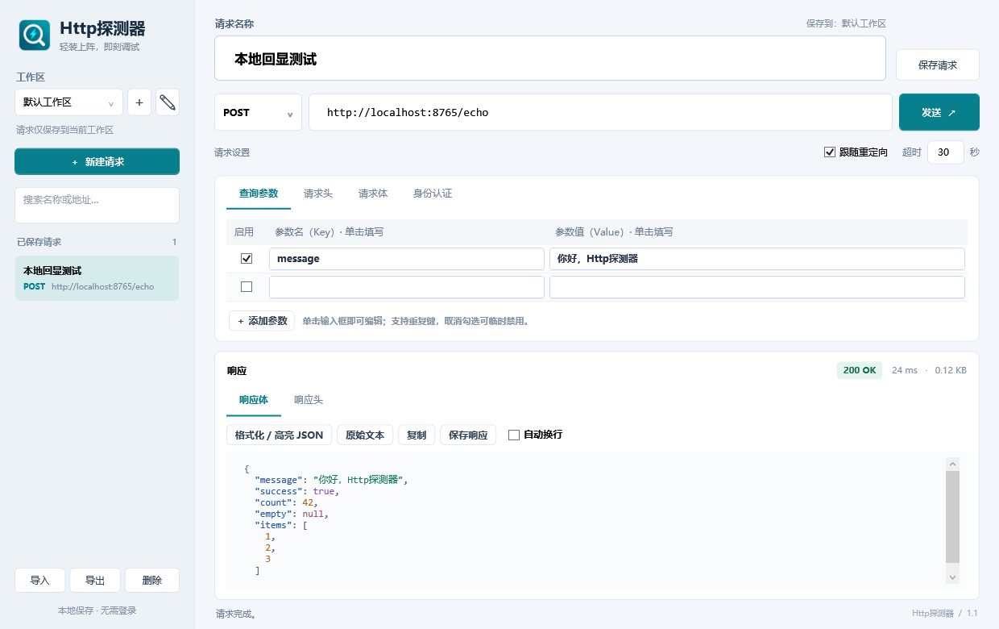

# Http探测器

一个轻量、启动快速的 Windows HTTP/HTTPS 接口测试工具。使用原生 WPF，不依赖浏览器内核、账号或云服务，适合管理开发与联调时常用的 API 请求。

[MIT 许可证](LICENSE) · [更新日志](CHANGELOG.md) · [贡献指南](CONTRIBUTING.md) · [安全说明](SECURITY.md) · [项目结构](docs/ARCHITECTURE.md)



## 功能

- 支持 HTTP、HTTPS 和 GET、POST、PUT、PATCH、DELETE、HEAD、OPTIONS、TRACE。
- 查询参数、请求头、表单字段使用清晰的键值输入格，支持重复键和单行禁用。
- 请求体支持 JSON、纯文本、URL 编码表单、Multipart 文本和文件上传。
- 支持 Bearer Token、Basic Auth、自定义请求头、超时、重定向控制和请求取消。
- 展示状态码、耗时、响应大小、响应头和正文；JSON 可格式化并按语法高亮。
- 支持按名称保存、搜索和加载请求，以及当前工作区的请求集合导入导出。
- 支持多个工作区，各自独立保存请求，并记住上次选择。
- 响应正文最多接收 10 MB，可直接导出文本或二进制原始字节。
- 数据和配置采用便携目录，不写入系统用户目录。

## 下载与安装

从仓库的 **Releases** 页面下载最新 ZIP。发布包提供两种形式：

- **portable**：程序较小，需要 Windows x64 上的 .NET Desktop Runtime 9；允许前滚到更新主版本运行时。
- **standalone**：包含 .NET 运行时，无需预先安装；程序文件较大，首次运行会解压随包携带的原生运行库。

解压后直接运行 `Http探测器.exe`。发布 ZIP 不包含任何个人请求数据。

## 快速开始

1. 在左侧选择或新建工作区，点击“新建请求”并填写请求名称。
2. 选择方法并输入包含 `http://` 或 `https://` 的完整地址。
3. 在查询参数、请求头、请求体或身份认证中添加所需内容。单击带边框的单元格直接编辑，也可以使用对话框中的添加按钮。
4. 点击“发送”或按 `Ctrl+Enter`。发送中再次点击按钮可取消请求。
5. 点击“保存请求”或按 `Ctrl+S`，请求会保存到当前工作区。
6. 对 JSON 响应点击“格式化 / 高亮 JSON”；“原始文本”可还原未格式化的内容。

本机回演示服务：安装 Python 后，在仓库根目录运行 `python scripts/echo_server.py`，再请求 `http://localhost:8765/echo`。

## 1.1 新增

- 左侧顶部增加工作区：下拉切换，“＋”新建，“✎”重命名。工作区各自保存请求，重新打开程序时恢复上次选择。
- 请求名称使用带边框的输入框，并显示保存目标工作区。查询参数、请求头、表单的 Key/Value 有独立输入框边界，单击即可编辑，也提供显式的添加按钮。
- “格式化 / 高亮 JSON”区分键名、字符串、数字、布尔值、null。原始文本、复制、自动换行、响应保存功能继续可用；保存响应始终保留原始字节。高亮采用可见区域绘制，不为每个 JSON token 创建界面控件。

## 请求与工作区操作

- **保存和加载**：左侧列出当前工作区中已保存的请求，可按名称、方法或地址搜索。修改名称后保存会更新当前请求。
- **工作区和数据范围**：切换工作区会提示保存未保存修改；请求发送期间工作区切换暂时禁用。不同工作区可使用相同的请求名称和 ID。
- **导入导出**：导入会向当前工作区添加新副本，不覆盖已有请求；导出只包含当前工作区，并用编辑中的当前请求替代其保存版本。
- **文件上传**：选择“文件 / Multipart”后，可选中行并点击“选择文件”。文件字段会保存本地路径，不保存文件内容。Content-Type 与 boundary 自动生成。
- **快捷键**：`Ctrl+Enter` 发送，`Ctrl+S` 保存，`Ctrl+N` 新建请求。

## 保存位置与边界

配置根目录：**EXE 所在目录下的 `data` 文件夹**，与快捷方式“起始位置”和终端当前目录无关。

例如轻量版为 `artifacts/v1.1/portable/data`，独立版为 `artifacts/v1.1/standalone/data`，两者位于不同目录时各自保存数据。

新版首次启动且 `data` 不存在时，会将旧版用户目录中的请求、工作区和备份文件完整复制到 `data`，旧目录保留作备份。迁移先在程序目录下的暂存目录完成，再整体切换；迁移失败不会启用不完整的数据。若 `data` 已存在，始终以它为准，不覆盖已有数据，也不重复导入旧数据。以后 Ctrl+S 只保存到 EXE 旁的 `data`，程序目录无法写入时会提示错误，不会切回用户目录保存。

- 默认工作区：继续使用原来的 `requests.json`。旧版保存的请求无需转换或复制即可加载。
- 其他工作区：`workspaces\<工作区ID>\requests.json`，各自独立保存。工作区名称与目录名分离，重命名不移动或清空请求文件。
- 工作区列表及当前选择：`workspaces.json`。

请求文件与工作区目录文件每次覆盖前都保留上一版 `.bak`，写入采用临时文件和原子替换。若当前请求文件或工作区目录损坏，程序保留原文件并停止对应写入；目标工作区请求文件损坏时，切换失败并保留当前编辑内容。备份原文件后可用 `.bak` 恢复。

请求配置与导出文件为明文 JSON，其中包含填写的令牌、密码、Cookie 和文件路径。`data`、备份和导出文件均不会提交到本仓库。请不要在 Issue、截图或 PR 中使用真实凭据和私人接口。

文件上传仅保存路径，再次使用时需保证原文件仍然存在。请求与响应只在点击“发送”后通过目标地址传输；程序不会自动发送示例请求。

HTTPS 使用系统证书验证，不忽略无效证书。使用系统代理配置，不提供独立代理编辑器。Cookie 不自动跨请求保存，需要时通过请求头设置；服务端 Set-Cookie 可在响应头查看。

响应接收上限为解压后 **10 MB**，超出时会提示截断；保存响应也只导出已接收的部分。耗时包括连接、请求及响应接收；大小为接收并解压后的正文大小。二进制响应可直接导出。工具不执行响应中的 HTML 或脚本。

## 开发与验证

需要 Windows 10/11 x64、PowerShell 7 和 .NET 9 SDK。项目不依赖第三方 NuGet 业务包，GitHub Actions 运行在 Windows 环境。

```powershell
dotnet restore HttpTester.sln --artifacts-path artifacts/build
dotnet build HttpTester.sln -c Release --artifacts-path artifacts/build
dotnet run --project src/HttpTester.App
pwsh -NoProfile -File scripts/test.ps1
pwsh -NoProfile -File scripts/publish.ps1 -Package
pwsh -NoProfile -File scripts/publish.ps1 -Standalone -Package
```

测试检查包括本机 HTTP/TLS 请求、参数编码、文件上传、认证、重定向、压缩、取消、超时、配置保存、工作区隔离、迁移恢复、JSON 分类，以及隔离 WPF 窗口的界面逻辑和布局。发布分发包及 SHA-256 生成方法见 [维护说明](docs/MAINTAINING.md)。

### 项目结构

```text
src/HttpTester.App/       WPF 桌面界面
src/HttpTester.Core/      请求执行、持久化和 JSON 分词
tests/HttpTester.Tests/   网络、存储与数据格式检查
tests/HttpTester.UiTests/ 隔离窗口逻辑与布局检查
scripts/                  本地服务、测试、图标和发布脚本
docs/                     架构、维护说明和演示图片
```

详细设计见 [docs/ARCHITECTURE.md](docs/ARCHITECTURE.md)。图标原图、尺寸资源和生成提示词位于 [src/HttpTester.App/Assets/ICON.md](src/HttpTester.App/Assets/ICON.md)。

## 参与贡献

- 提交问题前请先搜索已有 Issue，并使用问题或功能模板。
- 修复与功能变更请先阅读 [CONTRIBUTING.md](CONTRIBUTING.md)，保持 PR 范围清晰。
- 行为规范见 [CODE_OF_CONDUCT.md](CODE_OF_CONDUCT.md)。
- 安全漏洞请按 [SECURITY.md](SECURITY.md) 的报告渠道处理。

## 许可证

本项目以 [MIT 许可证](LICENSE) 发布。
